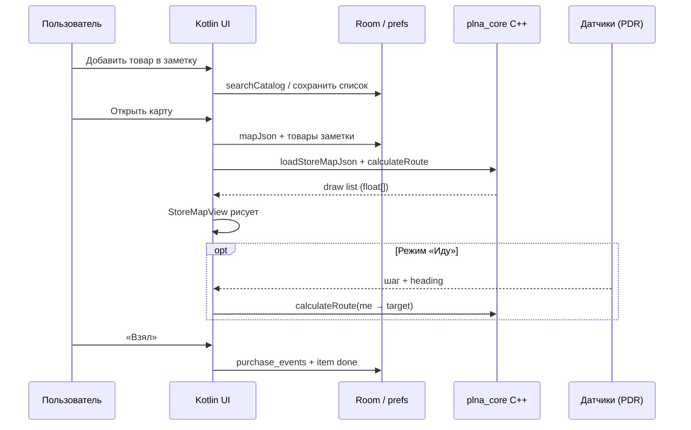

# Архитектура PLNA Заметки (Smart Map)

**Версия приложения:** 0.2.0 · package `by.smartplanogram.plnanote`

Документ для показа системы «как устроена»: UI → данные → нативное ядро карты.

Связанные материалы:

- [Почему C++, а не только Kotlin](WHY_CPP.md)
- [Native core (C++)](../app/src/main/cpp/docs/ARCHITECTURE.md)
- [C API](../app/src/main/cpp/docs/C_API.md)
- [Модель данных карты](../app/src/main/cpp/docs/DATA_MODEL.md)
- [Продукт](PRODUCT.md) · [Сборка](BUILD.md) · [Changelog](CHANGELOG.md)

---

## 1. Общая картина

```
┌──────────────────────────────────────────────────────────────────┐
│                        Android UI (Kotlin)                       │
│  Splash → Main (Home · Lists · Map · Profile)                    │
│  ListDetail · Insights · Auth · About                            │
│  StoreMapView рисует float[] draw-list (не считает геометрию)    │
└───────────────────────────────┬──────────────────────────────────┘
                                │
         ┌──────────────────────┼──────────────────────┐
         ▼                      ▼                      ▼
┌─────────────────┐   ┌──────────────────┐   ┌─────────────────────┐
│ UserSettings    │   │ ShoppingList /   │   │ OfflineRepository   │
│ SharedPrefs     │   │ PurchaseHistory  │   │ Room SQLite         │
│ тема, язык,     │   │ prefs / Room     │   │ магазины, товары,   │
│ локальный вход  │   │ заметки, «взял»  │   │ JSON плана зала     │
└─────────────────┘   └──────────────────┘   └──────────┬──────────┘
                                                       │
                              RtdbSyncEngine           │
                     assets/rtdb_export.json ──────────┤
                     Firebase RTDB (best-effort) ──────┘
                                                       │
                                                       │ JNI
                                                       ▼
┌──────────────────────────────────────────────────────────────────┐
│                     plna_core (C++23)                            │
│  MapScene · маршрут · buildDrawList · метры зала                 │
│  Один алгоритм → Android сейчас; iOS / desktop — тот же core     │
└──────────────────────────────────────────────────────────────────┘
```

**PDR (шаги «я» на карте)** живёт в Kotlin (`ui/map/pdr/`): датчики телефона → метры → `StoreMapView.setMe`. Маршрут по-прежнему считает C++ от текущей точки.

---

## 2. Поток «купил → дошёл до полки»

```
  Дома / по дороге                 В магазине
 ─────────────────                ─────────────
 1. Главная / Списки               4. Карта: якорь Вход или Кассы
 2. Поиск товара (Room)            5. C++: calculateRoute(from → item)
 3. Количество → заметка           6. Draw-list → план + линия маршрута
                                   7. (опц.) «Иду» — PDR двигает «я»
                                   8. «Показать полку» / «Взял»
                                   9. Insights пишет локальную историю
```



---

## 3. Слои ответственности

| Слой | Язык | Делает | Не делает |
|------|------|--------|-----------|
| UI | Kotlin | Экраны, жесты, Material 3, локализация | Геометрию зала, A* по проходам |
| Data | Kotlin | Room, sync, списки, аналитика покупок | Рендер карты |
| PDR | Kotlin | Шаги / акселерометр / компас → (x,y) | Планограмму |
| Core | C++23 | Сцена в метрах, маршрут, draw opcodes | UI, Firebase, prefs |

### Почему карта в C++

Кратко: **один движок на несколько платформ**, стабильный realtime-рендер, общая модель с экосистемой PLNA. Подробно — [WHY_CPP.md](WHY_CPP.md).

---

## 4. Данные: откуда берётся магазин

```
┌────────────────────┐     sync once / refresh      ┌──────────────┐
│ rtdb_export.json   │ ───────────────────────────► │ Room         │
│ (assets, офлайн)   │                              │ stores       │
└────────────────────┘                              │ products     │
┌────────────────────┐     best-effort               │ store_maps   │
│ Firebase RTDB      │ ───────────────────────────► │ app_prefs    │
└────────────────────┘                              └──────┬───────┘
                                                           │
                     UI search / map JSON ◄────────────────┘
```

В UI-поиск попадают **только** товары выбранного магазина из Room.  
Демо-каталог (`demo_catalog.json`) **не** подмешивается в поиск (лицо стеллажа может брать размеры по умолчанию).

Поля товара для навигации: `name`, `rackId`, `shelf`, `x`, `y` (+ кэш `store_maps` JSON для C++).

---

## 5. Контракт JNI ↔ Canvas

1. `NativeMapEngine.nativeLoadStoreMapJson(json)` — разобрать зал.
2. `calculateRoute(fromX, fromY, toX, toY)` — путь в метрах.
3. `nativeBuildDrawList()` → `float[]`: поток `opcode + args`.
4. `StoreMapView` интерпретирует opcodes (`Floor`, `Box2D`, `Line`, …) и рисует.

Host **не пересчитывает** метры стеллажей — только камера (zoom / rotate / fit) и оверлеи («я», старт, подсветка).

---

## 6. Модули Kotlin (ориентир)

| Класс / пакет | Роль |
|---------------|------|
| `PlnaApp` | Тема, язык, фоновый `ensureSynced()` |
| `OfflineRepository` | Room API для UI |
| `RtdbSyncEngine` | JSON → entities |
| `ShoppingListRepository` | Заметки пользователя |
| `PurchaseHistoryRepository` | Локальная аналитика «Мои покупки» |
| `NativeMapEngine` | JNI к `plna_core` |
| `ui.map.pdr.*` | PDR без маяков |
| `StorePicker` | Выбор магазина / снимка карты |

---

## 7. Безопасность релиза (0.2)

- `usesCleartextTraffic=false` + `network_security_config`
- Release: R8 minify + shrinkResources + `proguard-rules.pro`
- Backup rules: исключение служебных prefs
- Auth честно помечен как **демо-доступ** (локальный профиль, без облака)

Секреты (`google-services.json`, `local.properties`) — вне git; см. [GITHUB.md](GITHUB.md).
